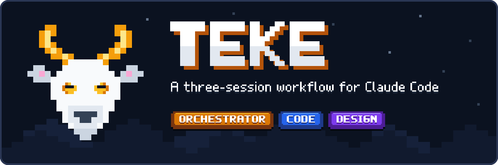
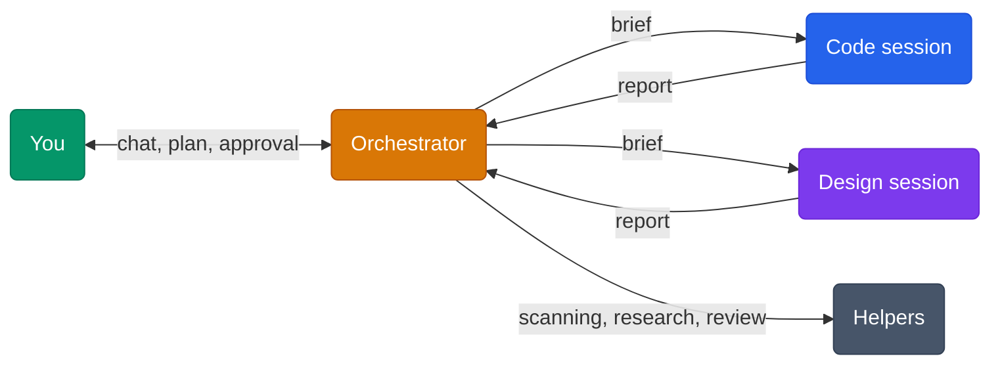
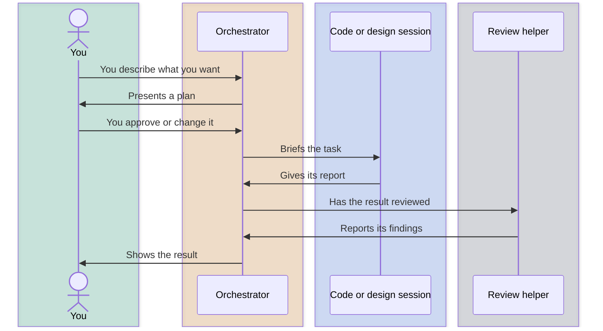

<div align="center">



<br>

**Run big jobs in Claude Code from a single chat.**

You talk only to the orchestrator; separate sessions do the code and the design, and another pair of eyes looks at every finished task.
The orchestrator warns you before the chat fills up and carries on from where it left off. It shows a plan before every task and asks you before a deploy.
It writes down your decisions, the questions waiting on you and the lessons learned from mistakes, and forgets none of them.

<br>


[Türkçe](README.md) · **English**

</div>

---

## What is Teke?

Teke is a way of working for running big jobs in Claude Code from a single chat. You install it in your project once. After that you talk only to the session we call the **orchestrator**: it listens to you, plans, hands the work to the code and design sessions, checks the result and shows it to you.

The orchestrator also keeps track of the work. It watches how full the chat is getting. It writes down your decisions and the lessons learned from mistakes, and reads the lessons again in every session and the decisions when a task that rests on them starts. It has independent helpers review finished work, and asks you before steps that are hard to undo, such as a deploy. While work is under way you keep chatting with it; asking a question or wanting something new does not disturb the sessions that are working.

Teke does not interfere with the models' intelligence. It does not dictate what they should do step by step or force them into a mould; it says what is wanted and where the limits are, and leaves the route to the model. What it does is set up the frame and keep things in order through a long project.

Inside are one rules file, three skills, five helpers and scripts that run in the background. All of it is installed in your project's `.claude/` folder.

> Teke was first written in Turkish (*teke* means "billy goat"). Everything you and Claude read is in English. The names of its script files and of the keys in its settings file are still Turkish; they are explained where they appear below.

## What does it give you?

| Feature | What you get |
|:--|:--|
| **One point of contact** | You talk only to the orchestrator. While code and design run in separate sessions you can ask questions and give new work; you do not have to interrupt a session that is working. |
| **Context tracking and compact** | As the chat grows, the room the model has for keeping things in mind (the context) fills up. Teke measures this; before it fills, it writes where you are to a file and asks you to type `/compact` (the command that summarises the chat and frees room). After that you carry on from where you were, without pasting anything. |
| **Plan first, then approval** | Before new work you see a plan: what will be done, which session will do it, which model will work with how much thinking, what will be needed from you and when. Big work waits for your approval; a small, clear task the orchestrator states in one sentence and starts. |
| **No question gets lost** | Every question, decision and approval the orchestrator is waiting on from you lives in one list. A blocking one is asked right away; a non-blocking one is collected and asked in a batch when the task is done. When you say "continue", the orchestrator first tells you whether anything is waiting on you. |
| **Your words are passed on as they are** | When the orchestrator hands off work, it writes your sentences verbatim and keeps its own interpretation in a separate section; a script checks that the quotes really appear in the chat. Even if you say ten separate things in one message, all of them are split into items and none is dropped silently. |
| **Whoever did the work does not review it** | Every finished piece of code and design (apart from a one-line fix) is looked at by helpers that did not do it: one looks for bugs, one looks for what the tests cannot see, one criticises the design. Nor does the orchestrator say "done" before it has seen the result with its own eyes. |
| **Design first, then code** | If something visible on screen is going to change, the design session draws the options first. You choose, and the code is written after that. |
| **Model and thinking level to fit the task** | For every task the orchestrator chooses how much thinking the session will work with and which model is used for scanning and for review, and tells you. You can change it. |
| **Lasting memory and lessons** | Your decisions, where you are, and the lessons learned from mistakes are written to documents in your project. Where you are and the lessons are read again at the start of every session, the decisions when a task that rests on them starts. Correcting the orchestrator once is enough: it writes the lesson, and later sessions start out knowing it. |
| **No deploy behind your back** | Commands that push to the remote or deploy run only in the orchestrator, with your approval; in the code and design sessions they are stopped. Which commands are asked about is written in the settings and can be changed per project. |
| **It adapts to you** | Saying "from now on, do it this way" is enough; the orchestrator writes it into the project's rules. Over time the setup takes the shape of the way you work, and grows with it. |

How each of these works is below, in [How do the features work?](#how-do-the-features-work)

## How do I install it?

In the Claude Code desktop app, open a session in your project's folder and type:

```
Download the repository https://github.com/muhammedkumcu/teke into the ~/teke folder, then read the SETUP.md file in it and apply it.
```

That is all you need to type. The session takes care of the rest; when the install is done, that session becomes the orchestrator and asks what you want to do.

> **What we suggest for the orchestrator:** the strongest model you have (Fable or Opus), high effort, and ultracode on. You choose all three in the app when you open the session. Ultracode is the Claude Code mode that runs work by splitting it across several helpers; with it on, scanning and review are more thorough.

The download happens once. After that, what you type is shorter still:

| What do you want to do? | What do you type? |
|:--|:--|
| Update Teke | To the orchestrator: "Update Teke." |
| Install Teke in another project | To the session you open in that project: "Read ~/teke/SETUP.md and apply it." |
| Change a habit | To the orchestrator: "From now on, write the plans in more detail." |

## How does it work?



- The **orchestrator** is the session that talks to you. It plans, writes the brief, verifies the result that comes back, and keeps the records. It does not produce the code or the design itself.
- The **code session** writes and runs the code and the tests. The **design session** prepares options for screens, images and the tone of a text; it does not touch application code.
- The code and design sessions are persistent. The same sessions are used throughout the project, so nothing has to be explained from scratch for every task. When they fill up, no new one is opened; compact frees room and they carry on from where they were.
- The **helpers** are short-lived. The orchestrator calls them for scanning, research and review; they close when their job is done.
- Tasks that do not wait on each other run together: design can be drawn while code is being written.
- If the task is small, or your app has no tools for opening sessions, everything runs in one session.

## How does a task go from start to finish?



A short example:

> **You:** Let's add a dark theme to the home screen.<br>
> **Orchestrator:** First the design session draws two colour schemes; you pick one, and then the code session builds it. All I will need from you is the choice. Shall I start?<br>
> **You:** Go.<br>
> **Orchestrator:** Sent to the design session. I will show you the options when they arrive.<br>
> *(some time later)*<br>
> **Orchestrator:** Two options are ready, and the critic has looked at them. Which one?<br>
> **You:** The second.<br>
> **Orchestrator:** Sent to the code session.<br>
> *(some time later)*<br>
> **Orchestrator:** Done. You can turn it on and off from the settings screen. The review found two small bugs; both are fixed.

## Which projects is it for?

It is used in a project that is just starting and in one that has been running for months. What you type to install it does not change; Teke behaves according to the state of the project.

| What state is your project in? | What does Teke do? |
|:--|:--|
| **You are just starting** | It creates the record documents. You go straight to work. |
| **You have code but no written setup** | It creates the record documents. In the first task the orchestrator reads the code and writes the project's description and commands itself. |
| **You have your own rules and documents** | Your documents are not moved and their names do not change. Your rules come before Teke's. If the two conflict, the orchestrator shows you and you decide. |
| **Teke is already installed** | You say "Update Teke". Your settings and documents are kept. |
| **The repository belongs to someone else** | You say so when installing. Teke's files do not go into the repository; they stay only on your computer. Your record documents then live in a `.teke/` folder. |

## What is added to my project?

Teke is downloaded to your computer once (`~/teke`). At install, its files are copied into your project; from then on the project works on its own, and the folder you downloaded is the source for updates.

Two kinds of files go into your project:

```
project/
├─ .claude/            Teke's own files: rules, skills, helpers, scripts, settings
│
├─ CLAUDE.md           rules and commands specific to your project
├─ STATUS.md           where you are: now, next, what is waiting on you
└─ docs/
   ├─ DECISIONS.md     the decisions you made, and why
   ├─ LESSONS.md       the lessons learned in this project
   ├─ handoff/         briefs and their reports
   └─ archive/         records that have gone stale (created on the first move)
```

- **Teke's own files** are the same in every project and are refreshed on update.
- **The record documents** belong to your project. They are created empty at install; as the orchestrator works, it fills them in for your project and your wishes. An update does not touch them.
- If your project already has one of these documents (your own `CLAUDE.md`, say), no new one is created; yours is used.
- A few lines are added to your `.gitignore`, for temporary files that concern only your computer.

## How do the features work?

### Context tracking and compact

- The chat's fullness is measured on each of your messages and in the middle of long tasks. At 50% the orchestrator tells you in one sentence. At 65% it prepares and, on the first line of its reply, asks you to type `/compact`.
- When the code or design session needs a compact and its next task has nothing to do with the previous, closed one, the orchestrator also mentions the `/clear` option: that session starts from zero, and the documents and lessons stay in place. You decide which to type.
- If a big task is coming, it does not wait for 65%: the orchestrator asks for the compact before the task. It also measures in advance how full the session it is about to give work to is; if that one is full, it asks for a compact there first.
- In the preparation, everything not yet in the documents is written to a note: decisions you just made, the exact place of half-finished work, the targets you stated. Questions waiting for an answer go into the list of what is waiting on you.
- After the compact, that note and where you were are loaded automatically. You do not have to paste anything.
- The code and design sessions watch their own fullness. A session that fills up stops at a suitable point; the orchestrator tells you which session to type `/compact` in.
- Typing `/compact` stays with you, because Claude Code runs it only when the user types it.

### What is waiting on you

- Everything the orchestrator is waiting on from you lives in one list in `STATUS.md`: a question you have not answered, a decision you said you would "talk about later", an approval you are to give, a trial you are to run on your own device, a suggestion you have not responded to.
- Each item says whether it blocks the work. A blocking question is asked right away. A non-blocking one does not cut in while work is under way; the orchestrator continues on a reasonable assumption, writes the assumption down, and asks the question together with the others when the task is done.
- When you type "continue", when a task closes, and after a compact, the list is shown in two groups: blocking and not blocking. If the list is empty, the orchestrator says it is not waiting on anything from you.
- Saying "continue" does not count as answering the questions. An item leaves the list in one of three ways: you answer it, you drop it, or it becomes moot.

### The brief

When the orchestrator gives a task to another session, it writes a file. It holds:

- **Your words,** verbatim. A script checks that these quotes really appear in the chat; if it cannot find a quote, it rejects the message once and names that quote.
- **The orchestrator's interpretation,** in a separate section.
- **Benchmark examples:** what you liked before and what you did not.
- **The skills to use:** the orchestrator chooses the ones that fit the task. Code work includes a code review (code-review) by default: the code session reviews its own change before committing. Simplification, security review and document-writing skills are added when needed. Design work is not sent without design skills.
- **When the task counts as done:** by what evidence (a test, a command, an image).

The brief says what is wanted and where the limits are; the session doing the work chooses how. That session does not ask you questions; its question goes to the orchestrator. If the session is silent for 13 minutes, the orchestrator is alerted; it may be stuck, or the computer may have gone to sleep. For long tasks the orchestrator also asks permission to keep the computer awake.

### Review, research and helpers

| Helper | What does it do? |
|:--|:--|
| **Scout** | Searches code and documents, counts, takes inventory. |
| **Bug hunter** | Looks in the changed files for the bugs and logic gaps you would notice. |
| **Test gaps** | Looks not at whether the tests pass but at what they fail to see. |
| **Critic** | Scores a design, a plan or a brief against your words and the examples you liked. It works without knowing who produced the options. |
| **Skeptic** | Confirms or refutes another helper's findings by going to the code. |

- When code work closes, the bug hunter looks at it; if behaviour changed, the test-gaps helper looks too. In design, the critic looks from at least two separate angles; a weak option is fixed before it reaches you.
- If there is a serious finding, the task does not close; it is fixed in the same session.
- No separate session is opened for research. The orchestrator does the reading and source gathering with helpers; if the job is big it lines them up in a workflow, that is, runs several helpers side by side and in sequence.
- The orchestrator chooses which helper works with which model and how much thinking: a light model for scanning, a strong model for work that needs judgment.
- Before running several helpers it tells you what it will set up and gets your approval. If ultracode is on, it sets it up without asking and tells you what it set up.
- The helpers' job is to review; they do not change files. Code is written by one hand, in the code session.
- The model of the code and design sessions comes from the settings (Opus to begin with). How much thinking they work with, the orchestrator chooses again for every task.

### Memory and lessons

Teke's memory is the documents in your project. Whether the chat is closed or summarised, nothing is lost, because everything that matters is written down and read again later.

| When? | What is written? |
|:--|:--|
| **When you make a decision** | The decision and its reason, right away, in `docs/DECISIONS.md` |
| **When you correct the orchestrator** | The lesson, right away, in `docs/LESSONS.md` |
| **When you are asked a question, or a decision is left for later** | The question, in the list of what is waiting on you |
| **When a task closes** | Where you are is updated. Corrections left in your messages and not yet written down are added as lessons. |
| **Before a compact** | Everything not yet in the documents, in a note |

| When? | What is read? |
|:--|:--|
| **Every time a session opens** (a new start, a reopen, after a compact or a clear) | The working rules, the rules specific to your project, where you are (the next task, what is waiting on you, the targets), the lessons (long ones shortened), the running briefs |
| **After a compact or a reopen** | In addition, the note written before the compact |
| **When starting a new task** | The decisions that concern that task |
| **When a task is handed to another session** | The brief. The relevant decisions, examples and lessons travel inside it, because that session does not see the chat. |

- Each piece of information has one place; which lives where is in the list above, under [What is added to my project?](#what-is-added-to-my-project)
- Work that rests on a decision is not sent before the decision arrives. An idea you postponed is not lost either; it is noted under "later".
- When a document grows too long, a script tells the orchestrator. A stale section is not deleted; it is moved to the archive as it is.
- If a lesson comes up that concerns not just your project but every project, the orchestrator also notes it in a file in the `~/teke` folder. That file stays on your computer and is sent nowhere.

### What the scripts guarantee

Most of the above are rules the orchestrator follows. The following are done by script; they run even if the orchestrator forgets.

| When? | What does the script do? |
|:--|:--|
| **When a session opens, and after a compact or a clear** | Loads where you are and the lessons. |
| **On every message and while a long task runs** | Measures fullness and gives notice when a threshold is crossed. Reminds the orchestrator of the lesson scan every 25 messages. |
| **When you type "continue"** | Puts the list of what is waiting on you in front of the orchestrator. |
| **When a task is sent to another session** | Checks that your words were not changed; rejects the message once if it cannot find a quote. |
| **When a helper is called** | Stops a helper opened with no model written, or with a model you have forbidden. |
| **When a command that needs approval is run** | Stops the command in the code and design sessions; in the orchestrator, asks you. |

If one of the scripts fails, your work does not stop. You can switch off a script you do not want in the settings.

## Details

<details>
<summary><b>Settings</b></summary>

<br>

The settings are in `.claude/teke/ayar.json` (*ayar* means "setting"). To change one, telling the orchestrator is enough; you can also edit the file by hand. An update keeps your settings. The key names are Turkish; this table says what each one is.

| Setting | What is it for? | Starting value |
|:--|:--|:--|
| `roller.kod`, `roller.tasarim` | The model of the code and design sessions and the thinking level they open with (`efor`) | `opus`, `high` |
| `roller.ajanIsci`, `roller.ajanHakem` | The model of the scanning helpers and of the review helpers | `sonnet`, `opus` |
| `ajan.yasakModeller` | Models you do not want used for helpers | empty |
| `ajan.modelZorunlu` | Stop a helper call that has no model written | on |
| `ajan.forkYasak` | Do not open a helper as a copy of the orchestrator (on its model) | on |
| `ders.hatirlatMesaj` | How many messages pass between lesson-scan reminders | 25 |
| `baglam.bildirYuzde`, `baglam.compactYuzde` | The notice and compact thresholds, in percent | 50, 65 |
| `baglam.pencere` | Your model's context window (measured at install) | 1,000,000 |
| `onay.desenler` | The commands you are asked about every time | pushing to the remote, deploying, writing to a remote database |
| `belge.yollar` | The mapping, if your documents have different names | empty |
| `commit.ortakYazarYasak` | Do not add a co-author line to commit messages | off |
| `kapaliKancalar` | The file names of the scripts you want switched off | empty |
| `dil` | The install language (`en` or `tr`) | `en` with this page's install line |

If you want the same preferences in every new project, create a file named `~/teke/kit/ayarlar/kisisel.json` and write them there. The installer applies it at first install.

</details>

<details>
<summary><b>Language</b></summary>

<br>

Teke installs in English or Turkish. The language is chosen at first install and kept in the settings; you do not have to say it again when updating. The install line on this page installs in English. The Turkish install is described in [README.md](README.md).

The scripts are the same in both languages. What changes is the text the orchestrator and you read, and the names of the files created in your project: a Turkish install creates `DEVAM.md` instead of `STATUS.md` and `docs/devir/` instead of `docs/handoff/`.

You can change the language of an installed project later; telling the orchestrator is enough. Your documents are not renamed; they go on being used where they are.

</details>

<details>
<summary><b>For those who want to develop Teke</b></summary>

<br>

| Path | What is in it? |
|:--|:--|
| `SETUP.md`, `KURULUM.md` | The instructions the installing session follows (English, Turkish) |
| `kit/kancalar/` | The scripts that run on their own, as hooks (shared by both languages) |
| `kit/araclar/` | The tools: installer, health check, maintenance, lesson scan, silence watch, tests (shared by both languages) |
| `kit/ayarlar/` | The starting settings |
| `kit/dil/en/` | The English texts: the rules file, three skills, five helpers, document templates, and the translation of the scripts' messages (`dil.json`) |
| `kit/dil/tr/` | The same in Turkish |

Make your change under `kit/`, then run the tests:

```
node kit/araclar/testler.js
```

The tests install and exercise both languages. If a rule, skill or template gains or loses a section or an item in only one of the two languages, the tests fail. The same goes for a script message with no translation.

</details>

## License

[MIT](LICENSE)

<div align="center">
<br>
<sub>teke: a billy goat. Stubborn and fond of slopes, it walks at the head of the herd and sees nearly everything through its horizontal pupils.</sub>
</div>
