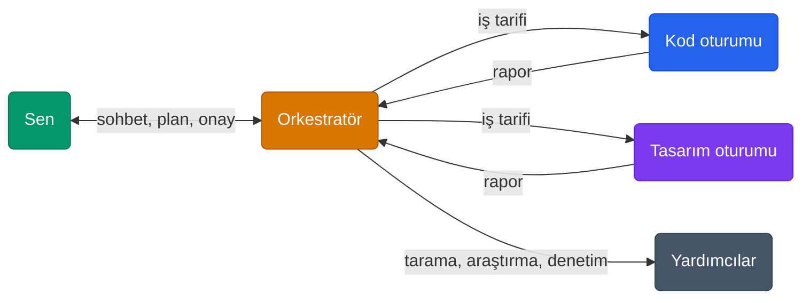
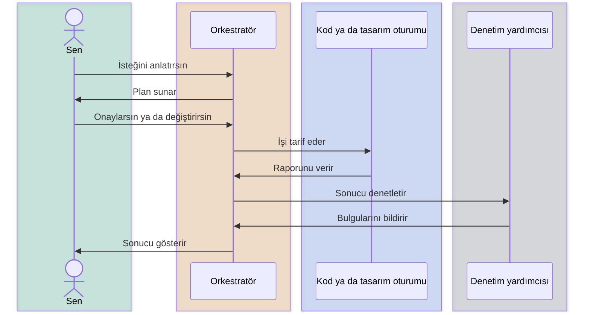

<div align="center">


<br>

**Claude Code'da tek bir oturumla konuşursun. Kodu ve tasarımı ayrı oturumlar yapar, biten her işe başka bir göz bakar.**

<br>


**Türkçe** · [English](README.en.md)

</div>

---

## Teke nedir?

Teke, Claude Code'da büyük işleri tek bir sohbetten yönetmek için hazırlanmış bir çalışma düzenidir. Projene bir kez kurarsın. Sonra yalnızca **orkestratör** dediğimiz oturumla konuşursun: seni dinler, planlar, işi kod ve tasarım oturumlarına verir, sonucu denetleyip sana gösterir.

Orkestratör işin takibini de üstlenir. Sohbetin ne kadar dolduğunu izler, kararlarını ve hatalardan çıkan dersleri yazar, dersleri her oturumda, kararları ilgili işe başlarken yeniden okur, biten işi bağımsız yardımcılara denetletir, yayın gibi geri dönüşü zor adımlarda sana sorar. İş sürerken onunla sohbet etmeye devam edersin; soru sorman ya da yeni bir şey istemen çalışan oturumları aksatmaz.

Teke modellerin zekâsına karışmaz. Onlara adım adım ne yapacaklarını dikte etmez, onları kalıba sokmaz; ne istendiğini ve sınırları söyler, yolu modele bırakır. Yaptığı şey çerçeveyi kurmak ve uzun bir projede düzenin bozulmadan sürmesini sağlamaktır.

İçinde bir kural dosyası, üç beceri (skill), beş yardımcı ve arka planda çalışan betikler (küçük programlar) var. Hepsi projenin `.claude/` klasörüne kurulur.

## Neler sağlar?

| Özellik | Sana ne sağlar? |
|:--|:--|
| **Tek muhatap** | Yalnızca orkestratörle konuşursun. Kod ve tasarım ayrı oturumlarda sürerken soru sorabilir, yeni iş verebilirsin; çalışan oturumu bölmen gerekmez. |
| **Bağlam takibi ve compact** | Sohbet uzadıkça modelin aklında tutabildiği yer (bağlam) dolar. Teke bunu ölçer; dolmadan önce kaldığın yeri dosyaya yazar ve senden `/compact` yazmanı ister (sohbeti özetleyip yer açan komut). Sonrasında hiçbir şey yapıştırmadan kaldığın yerden sürersin. |
| **Önce plan, sonra onay** | Yeni işten önce plan görürsün: ne yapılacak, hangi oturum yapacak, hangi model ne kadar düşünerek çalışacak, senden ne zaman ne gerekecek. Büyük iş onayını bekler; küçük ve net işi orkestratör tek cümleyle söyleyip başlatır. |
| **Soru kaybolmaz** | Senden beklenen her soru, karar ve onay tek listede durur. İşi durduran hemen sorulur; durdurmayan biriktirilir ve iş bitince toplu sorulur. "devam" dediğinde orkestratör önce senden bekleyen bir şey olup olmadığını söyler. |
| **Sözün olduğu gibi iletilir** | Orkestratör iş verirken senin cümlelerini aynen yazar, kendi yorumunu ayrı tutar; bir betik bunu denetler. Tek mesajda on ayrı şey söylesen de hepsi maddelere ayrılır, hiçbiri sessizce düşmez. |
| **Yapan denetlemez** | Biten her kod ve tasarım işine, o işi yapmamış yardımcılar bakar: biri hata arar, biri testlerin göremediğini arar, biri tasarımı eleştirir. Orkestratör de sonucu kendi gözüyle görmeden "bitti" demez. |
| **Önce tasarım, sonra kod** | Ekranda görünen bir şey değişecekse tasarım oturumu önce seçenekleri çizer. Sen seçersin, kod ondan sonra yazılır. |
| **İşe göre model ve düşünme düzeyi** | Her iş için oturumun ne kadar düşünerek çalışacağını, taramada ve denetimde hangi modelin kullanılacağını orkestratör seçer ve sana söyler. İstersen değiştirirsin. |
| **Kalıcı hafıza ve dersler** | Kararların, kaldığın yer ve hatalardan çıkan dersler projendeki belgelere yazılır. Kaldığın yer ve dersler her oturum açılışında, kararlar ilgili işe başlarken yeniden okunur. Orkestratörü bir kez düzeltmen yeter: dersi yazar, sonraki oturumlar onu bilerek başlar. |
| **Senden habersiz yayın yok** | Uzak depoya gönderme ve yayın komutları yalnızca orkestratörde, senin onayınla çalışır; kod ve tasarım oturumlarında durdurulur. Hangi komutların sorulacağı ayarlarda yazar, projene göre değiştirilir. |
| **Sana göre şekillenir** | "Bundan sonra şöyle yap" demen yeter; orkestratör bunu projenin kurallarına yazar. Düzen zamanla senin çalışma biçiminle şekillenir ve gelişir. |

Her birinin nasıl işlediği aşağıda, [Özellikler nasıl işler?](#özellikler-nasıl-işler) bölümünde.

## Nasıl kurulur?

Claude Code masaüstü uygulamasında, projenin klasöründe bir oturum aç ve şunu yaz:

```
https://github.com/muhammedkumcu/teke deposunu ~/teke klasörüne indir, sonra içindeki KURULUM.md dosyasını oku ve uygula.
```

Yazman gereken tek şey bu. Gerisini o oturum halleder; kurulum bitince o oturum orkestratör olur ve ne yapmak istediğini sorar.

> **Orkestratör için önerimiz:** elindeki en güçlü model (Fable ya da Opus), yüksek düşünme düzeyi (high) ve ultracode açık. Üçünü de oturumu açarken uygulamadan seçersin. Ultracode, Claude Code'un işi birden çok yardımcıya bölerek yürüttüğü kiptir; açıkken tarama ve denetim daha kapsamlı olur.

İndirme bir kez yapılır. Sonrasında yazacakların daha da kısadır:

| Ne yapmak istiyorsun? | Ne yazarsın? |
|:--|:--|
| Teke'yi güncellemek | Orkestratöre: "Teke'yi güncelle." |
| Teke'yi başka bir projene kurmak | O projede açtığın oturuma: "~/teke/KURULUM.md dosyasını oku ve uygula." |
| Bir alışkanlığı değiştirmek | Orkestratöre: "Bundan sonra planları daha ayrıntılı yaz." |

## Nasıl çalışır?



- **Orkestratör** seninle konuşan oturumdur. Planlar, iş tarifini yazar, gelen sonucu doğrular, kayıt tutar. Kodu ve tasarımı kendisi üretmez.
- **Kod oturumu** kodu ve testleri yazar, çalıştırır. **Tasarım oturumu** ekran, görsel ve metin tonu için seçenek çizer; uygulama koduna dokunmaz.
- Kod ve tasarım oturumları kalıcıdır. Proje boyunca aynı oturumlar kullanılır, her işte baştan anlatmak gerekmez. Dolduklarında yenisi açılmaz; compact ile yer açılır ve kaldıkları yerden sürerler.
- **Yardımcılar** kısa ömürlüdür. Orkestratör onları tarama, araştırma ve denetim için çağırır; işleri bitince kapanırlar.
- Birbirini beklemeyen işler birlikte yürür: kod yazılırken tasarım çizilebilir.
- İş küçükse ya da uygulamanda oturum açma araçları yoksa her şey tek oturumda yürür.

## Bir iş baştan sona nasıl ilerler?



Kısa bir örnek:

> **Sen:** Ana ekrana karanlık tema ekleyelim.<br>
> **Orkestratör:** Önce tasarım oturumu iki renk düzeni çizsin, sen seç, sonra kod oturumu uygulasın. Senden yalnızca seçim gerekecek. Başlayayım mı?<br>
> **Sen:** Başla.<br>
> **Orkestratör:** Tasarım oturumuna gönderdim. Seçenekler gelince göstereceğim.<br>
> *(bir süre sonra)*<br>
> **Orkestratör:** Bitti. Ayarlar ekranından açıp kapatabilirsin. Denetim iki küçük hata buldu, ikisi de düzeltildi.

## Hangi projelerde kullanılır?

Yeni başlayan projede de, aylardır süren projede de kullanılır. Kurarken yazdığın şey değişmez; Teke projenin hâline göre davranır.

| Projen ne durumda? | Teke ne yapar? |
|:--|:--|
| **Yeni başlıyorsun** | Kayıt belgelerini açar. Doğrudan işe geçersin. |
| **Kodun var, yazılı bir düzenin yok** | Kayıt belgelerini açar. Orkestratör ilk işte kodu okur, projenin tanımını ve komutlarını kendisi yazar. |
| **Kendi kuralların ve belgelerin var** | Belgelerin taşınmaz, adları değişmez. Senin kuralların Teke'nin kurallarından önce gelir. İkisi çelişirse orkestratör sana gösterir, kararı sen verirsin. |
| **Teke zaten kurulu** | "Teke'yi güncelle" dersin. Ayarların ve belgelerin korunur. |
| **Depo başkasına ait** | Kurarken söylersin. Teke'nin dosyaları depoya girmez, yalnızca senin bilgisayarında kalır. Kayıt belgelerin `.teke/` klasöründe durur. |

## Projene ne eklenir?

Teke bilgisayarına bir kez iner (`~/teke`). Kurulumda dosyaları projenin içine kopyalanır; proje ondan sonra kendi başına çalışır, indirdiğin klasör güncellemelerin kaynağı olur.

Projene iki tür dosya girer:

```
proje/
├─ .claude/           Teke'nin kendi dosyaları: kurallar, beceriler, yardımcılar, betikler, ayarlar
│
├─ CLAUDE.md          projene özgü kurallar ve komutlar
├─ DEVAM.md           kaldığın yer: şu an, sıradaki, senden beklenenler
└─ docs/
   ├─ KARARLAR.md     verdiğin kararlar ve gerekçeleri
   ├─ DERSLER.md      bu projede çıkan dersler
   ├─ devir/          iş tarifleri ve raporları
   └─ arsiv/          eskiyen kayıtlar (gerektiğinde açılır)
```

- **Teke'nin kendi dosyaları** her projede aynıdır ve güncellemede yenilenir.
- **Kayıt belgeleri** senin projene aittir. Kurulumda boş açılır; orkestratör çalıştıkça onları senin projene ve senin isteklerine göre doldurur. Güncelleme bu belgelere dokunmaz.
- Projende bu belgelerden biri zaten varsa (örneğin kendi `CLAUDE.md` dosyan) yenisi açılmaz, seninki kullanılır.
- `.gitignore` dosyana, yalnızca senin bilgisayarını ilgilendiren geçici dosyalar için birkaç satır eklenir.

## Özellikler nasıl işler?

### Bağlam takibi ve compact

- Sohbetin ne kadar dolduğu her mesajında ve uzun işlerin ortasında ölçülür. %50'de orkestratör tek cümleyle haber verir. %65'te hazırlığını yapar ve yanıtının ilk satırında senden `/compact` yazmanı ister.
- Kod ya da tasarım oturumu için compact gerektiğinde, o oturumun önceki işi kapanmışsa ve sıradaki iş onunla tamamen ilgisizse orkestratör `/clear` seçeneğini de söyler: o oturum sıfırdan başlar, belgeler ve dersler yerinde kalır. Hangisini yazacağına sen karar verirsin.
- Büyük bir işe girilecekse %65 beklenmez: orkestratör compact'ı işten önce ister. İş vereceği oturumun doluluğunu da önceden ölçer; doluysa önce orada compact ister.
- Hazırlıkta, belgelere henüz girmemiş her şey bir nota yazılır: yeni verdiğin kararlar, yarım işin tam yeri, söylediğin hedefler. Cevap bekleyen sorular senden beklenenler listesine girer.
- Compact'tan sonra bu not ve kaldığın yer kendiliğinden yüklenir. Bir şey yapıştırman gerekmez.
- Kod ve tasarım oturumları kendi doluluklarını kendileri izler. Dolan oturum uygun bir yerde durur; orkestratör sana hangi oturumda `/compact` yazacağını söyler.
- `/compact` yazmak sende kalır, çünkü Claude Code bunu yalnızca kullanıcının yazmasıyla çalıştırır.

### Senden beklenenler

- Orkestratörün senden beklediği her şey durum belgesinde tek listede durur: cevaplamadığın soru, "sonra konuşuruz" dediğin karar, vereceğin onay, kendi cihazında yapacağın deneme, karşılık vermediğin öneri.
- Her maddenin yanında işi durdurup durdurmadığı yazar. İşi durduran soru hemen sorulur. Durdurmayan soru iş sürerken araya girmez; orkestratör makul bir varsayımla sürer, varsayımını yazar ve soruyu iş bitince ötekilerle birlikte sorar.
- Sen "devam" yazdığında, bir iş kapandığında ve compact'tan sonra liste iki grupta gösterilir: işi durduranlar ve durdurmayanlar. Liste boşsa orkestratör senden bir şey beklemediğini söyler.
- "devam" demek soruları cevaplamış sayılmaz. Madde listeden ancak sen cevaplayınca, vazgeçince ya da geçersiz kalınca çıkar.

### İş tarifi

Orkestratör bir işi başka oturuma verirken bir dosya yazar. İçinde şunlar durur:

- **Senin sözün,** aynen. Bir betik bu alıntıların sohbette gerçekten geçtiğine bakar; bulamadığı alıntıyı bir kez geri çevirir ve hangisi olduğunu söyler.
- **Orkestratörün yorumu,** ayrı bir bölümde.
- **Örnek alınacak işler:** önceden beğendiklerin ve beğenmediklerin.
- **Kullanılacak beceriler (skill):** işe uygun olanları orkestratör seçer. Kod işinde kod incelemesi (code-review) varsayılandır: kod oturumu commit'ten önce kendi değişikliğini inceler. Gerektiğinde sadeleştirme, güvenlik incelemesi ve belge yazımı becerileri eklenir. Tasarım işi tasarım becerileri olmadan gönderilmez.
- **İşin ne zaman bitmiş sayılacağı:** hangi kanıtla (test, komut, görüntü).

Tarif ne istendiğini ve sınırları söyler; nasıl yapılacağını işi yapan oturum seçer. İşi alan oturum sana soru sormaz, sorusu orkestratöre gider. Oturum 13 dakika ses vermezse orkestratör uyarılır; takılmış ya da bilgisayar uyumuş olabilir. Uzun işlerde orkestratör bilgisayarın uyumaması için de izin ister.

### Denetim, araştırma ve yardımcılar

| Yardımcı | Ne yapar? |
|:--|:--|
| **Tarayıcı** | Kodda ve belgelerde arar, sayar, döküm çıkarır. |
| **Hata avcısı** | Değişen dosyalarda senin fark edeceğin hataları ve mantık açıklarını arar. |
| **Test körlüğü** | Testlerin geçip geçmediğine değil, neyi görmediğine bakar. |
| **Eleştirmen** | Tasarımı, planı ya da iş tarifini senin sözüne ve beğendiğin örneklere göre puanlar. Seçenekleri kimin ürettiğini bilmeden çalışır. |
| **Şüpheci** | Başka bir yardımcının bulgularını koda giderek doğrular ya da çürütür. |

- Kod işi kapanırken hata avcısı bakar; davranış değiştiyse test körlüğü de bakar. Tasarımda eleştirmen en az iki ayrı açıdan bakar; zayıf seçenek sana gelmeden düzelttirilir.
- Önemli bir bulgu varsa iş kapanmaz, aynı oturuma düzelttirilir.
- Araştırma için ayrı oturum açılmaz. Okuma ve kaynak toplama işini orkestratör yardımcılarla yapar; iş büyükse onları bir iş akışına (workflow) dizer, yani birkaç yardımcıyı yan yana ve sırayla çalıştırır.
- Hangi yardımcının hangi modelle ve ne kadar düşünerek çalışacağını orkestratör seçer: taramada hafif model, yargı gerektiren işte güçlü model.
- Birden çok yardımcı çalıştırmadan önce ne kuracağını sana söyler ve onayını alır. Ultracode açıksa sormadan kurar, ne kurduğunu söyler.
- Yardımcıların görevi incelemektir, dosya değiştirmezler. Kod tek elden, kod oturumunda yazılır.
- Kod ve tasarım oturumlarının modeli ayarlardan gelir (başlangıçta Opus). Ne kadar düşünerek çalışacaklarını orkestratör her işte yeniden seçer.

### Hafıza ve dersler

Teke'nin hafızası projendeki belgelerdir. Sohbet kapansa da özetlense de bilgi kaybolmaz, çünkü önemli olan her şey yazılır ve sonra yeniden okunur.

| Ne zaman? | Ne yazılır? |
|:--|:--|
| **Bir karar verdiğinde** | Karar ve gerekçesi, aynı anda karar defterine |
| **Orkestratörü düzelttiğinde** | Ders, aynı anda ders defterine |
| **Sana bir soru sorulduğunda ya da bir karar sonraya kaldığında** | Soru, senden beklenenler listesine |
| **Bir iş kapanırken** | Kaldığın yer güncellenir. Orkestratör senin mesajlarını yeniden okur; yaptığın ama yazılmamış kalan düzeltmeleri ders olarak ekler. |
| **Compact'tan önce** | Belgelere henüz girmemiş her şey bir nota |

| Ne zaman? | Ne okunur? |
|:--|:--|
| **Oturum her açıldığında** (yeni açılış, yeniden açma, compact ya da clear sonrası) | Çalışma kuralları, projene özgü kurallar, kaldığın yer (sıradaki iş, senden beklenenler, hedefler), dersler (uzun olan kısaltılarak), süren iş tarifleri |
| **Compact'tan ya da yeniden açmadan sonra** | Bunlara ek olarak compact'tan önce yazılan not |
| **Yeni bir işe başlarken** | O işi ilgilendiren kararlar |
| **İş başka oturuma verilirken** | İş tarifi. İlgili kararlar, örnekler ve dersler onun içinde gider, çünkü o oturum sohbeti görmez. |

- Her bilginin tek bir yeri vardır; hangisinin nerede durduğu yukarıda, [Projene ne eklenir?](#projene-ne-eklenir) bölümündeki listede.
- Karar gelmeden o karara dayanan iş gönderilmez. Ertelediğin fikir de kaybolmaz, "sonraya" diye not edilir.
- Çok uzayan belgeyi bir betik orkestratöre bildirir. Eskiyen bölüm silinmez, arşive olduğu gibi taşınır.
- Yalnızca senin projeni değil her projeyi ilgilendiren bir ders çıkarsa orkestratör onu `~/teke` klasöründeki bir dosyaya da not eder. Bu dosya bilgisayarında kalır, hiçbir yere gönderilmez.

### Betiklerin güvenceye aldıkları

Yukarıdakilerin çoğu orkestratörün uyduğu kurallardır. Aşağıdakiler ise betikle yapılır; orkestratör unutsa da çalışır.

| Ne zaman? | Betik ne yapar? |
|:--|:--|
| **Oturum açılınca, compact ve clear'dan sonra** | Kaldığın yeri ve dersleri yükler. |
| **Her mesajda ve uzun iş sürerken** | Doluluğu ölçer, eşik aşılınca haber verir. Uzun süredir ders taraması yapılmadıysa hatırlatır. |
| **Sen "devam" yazınca** | Senden beklenenlerin listesini orkestratörün önüne koyar. |
| **İş başka oturuma gönderilirken** | Senin sözünün değiştirilmediğine bakar; bulamadığı alıntıyı bir kez geri çevirir. |
| **Bir yardımcı çağrılırken** | Modeli yazılmamış ya da yasakladığın modelle açılan yardımcıyı durdurur. |
| **Onay isteyen bir komut çalıştırılırken** | Kod ve tasarım oturumunda komutu durdurur; orkestratörde sana sorar. |

Betiklerden biri hata verirse işin durmaz. İstemediğin betiği ayarlardan kapatabilirsin.

## Ayrıntılar

<details>
<summary><b>Ayarlar</b></summary>

<br>

Ayarlar `.claude/teke/ayar.json` dosyasındadır. Orkestratöre söylemen yeter; istersen elle de düzenleyebilirsin. Güncelleme ayarlarını korur.

| Ayar | Ne işe yarar? | Başlangıç değeri |
|:--|:--|:--|
| `roller.kod`, `roller.tasarim` | Oturumların modeli ve açılıştaki düşünme düzeyi | `opus`, `high` |
| `roller.ajanIsci`, `roller.ajanHakem` | Tarama ve denetim yardımcılarının modeli | `sonnet`, `opus` |
| `ajan.yasakModeller` | Yardımcılarda kullanılmasını istemediğin modeller | boş |
| `ajan.modelZorunlu` | Modeli yazılmamış yardımcı çağrısı durdurulsun | açık |
| `ajan.forkYasak` | Yardımcı, orkestratörün kopyası olarak (onun modeliyle) açılmasın | açık |
| `ders.hatirlatMesaj` | Kaç mesajda bir ders taraması hatırlatılsın | 25 |
| `baglam.bildirYuzde`, `baglam.compactYuzde` | Haber ve compact eşikleri | 50, 65 |
| `baglam.pencere` | Modelinin bağlam penceresi (kurulumda ölçülür) | 1.000.000 |
| `onay.desenler` | Her seferinde sana sorulacak komutlar | uzak depoya gönderme, yayın, uzak veritabanına yazma |
| `belge.yollar` | Belgelerinin adı farklıysa eşleme | boş |
| `commit.ortakYazarYasak` | Commit mesajına ortak yazar satırı eklenmesin | kapalı |
| `kapaliKancalar` | Kapatmak istediğin betiklerin dosya adları | boş |
| `dil` | Kurulum dili (`tr` ya da `en`) | `tr` |

Her yeni projende aynı tercihleri istiyorsan `~/teke/kit/ayarlar/kisisel.json` adında bir dosya açıp oraya yaz. Kurucu ilk kurulumda uygular.

</details>

<details>
<summary><b>Dil</b></summary>

<br>

Teke Türkçe ve İngilizce kurulur. Dil ilk kurulumda seçilir ve ayarda saklanır; güncellemede yeniden söylemen gerekmez. Bu sayfadaki kurulum cümlesi Türkçe kurar. İngilizce kurulum [README.en.md](README.en.md) sayfasında anlatılır.

İki dilde betikler aynıdır. Değişen, orkestratörün ve senin okuduğun metinler ile projene açılan dosyaların adlarıdır: İngilizce kurulumda `DEVAM.md` yerine `STATUS.md`, `docs/devir/` yerine `docs/handoff/` açılır.

Kurulu bir projenin dilini sonradan değiştirebilirsin; orkestratöre söylemen yeter. Belgelerin yeniden adlandırılmaz, oldukları yerde kullanılmaya devam eder.

</details>

<details>
<summary><b>Teke'yi geliştirmek isteyenler için</b></summary>

<br>

| Klasör | İçinde ne var? |
|:--|:--|
| `KURULUM.md`, `SETUP.md` | Kuran oturumun izlediği talimat (Türkçe, İngilizce) |
| `kit/kancalar/` | Kendiliğinden çalışan betikler (iki dilde ortak) |
| `kit/araclar/` | Kurucu, sağlık kontrolü, bakım, ders taraması, sessizlik nöbeti, testler (iki dilde ortak) |
| `kit/ayarlar/` | Başlangıç ayarları |
| `kit/dil/tr/` | Türkçe metinler: kural dosyası, üç beceri, beş yardımcı, belge şablonları |
| `kit/dil/en/` | Aynılarının İngilizcesi ve betik metinlerinin çevirisi (`dil.json`) |

Değişikliği `kit/` altında yap, sonra testleri çalıştır:

```
node kit/araclar/testler.js
```

Testler iki dili de kurup sınar. Bir kural, beceri ya da şablon yalnız bir dilde bölüm ya da madde kazanır ya da yitirirse, ya da bir betik metninin çevirisi yoksa test kalır.

</details>

## Lisans

[MIT](LICENSE)

<div align="center">
<br>
<sub>teke: erkek keçi, inatçı, yokuşu sever, sürünün önünde yürür, yatay gözbebekleriyle neredeyse her yeri görür.</sub>
</div>
